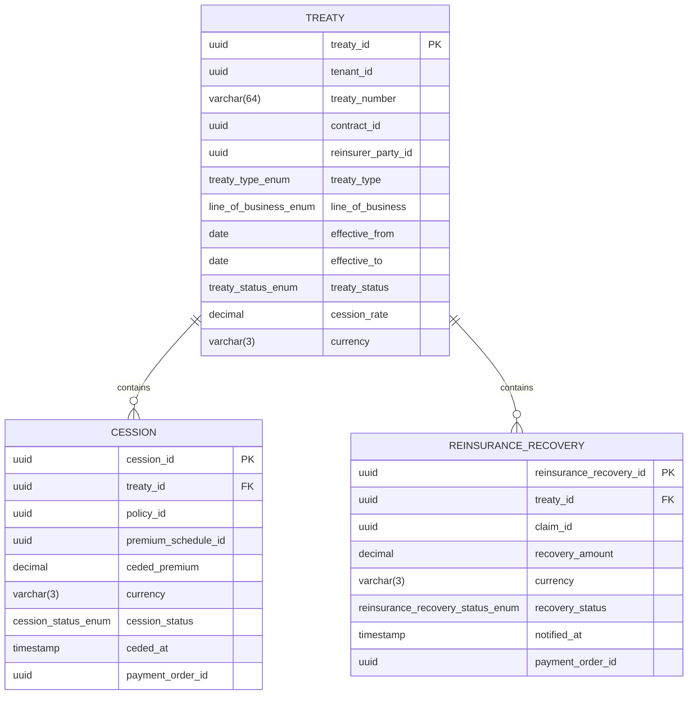

<a href="https://fireflysoftware.io/openplatform/">
<picture>
  <source media="(max-width: 640px) and (prefers-color-scheme: dark)" srcset="https://raw.githubusercontent.com/firefly-oss/.github/main/profile/assets/banner-narrow-dark.svg">
  <source media="(max-width: 640px)" srcset="https://raw.githubusercontent.com/firefly-oss/.github/main/profile/assets/banner-narrow-light.svg">
  <source media="(prefers-color-scheme: dark)" srcset="https://raw.githubusercontent.com/firefly-oss/.github/main/profile/assets/banner-dark.svg">
  
</picture>
</a>

# Firefly OpenPlatform - Core Insurance - Reinsurance

Developed by the Firefly Software Foundation. [dev@fireflysoftware.io](mailto:dev@fireflysoftware.io)

[Website](https://fireflysoftware.io/) · [OpenPlatform](https://fireflysoftware.io/openplatform/) · [Module catalogue](https://fireflysoftware.io/openplatform/modules/)

Core repository for reinsurance treaties, policy cessions, and claim recoveries.

Repository: [https://github.com/firefly-oss/core-insurance-reinsurance](https://github.com/firefly-oss/core-insurance-reinsurance)

Stores the cession and the recovery the insurer records. Placement, pricing, and the reinsurer's acceptance stay with the reinsurer. Premium cash movement stays in core-banking-payments.

This is a **core** service. It owns its tables and exposes a reactive CRUD API. It does not call other core services. Domain orchestration is intentionally not in this repository.

## What it does not own

- The reinsurer as a party. reinsurerPartyId points at core-common-customer-mgmt.
- The policy and the claim. Those ids point at core-insurance-policies and core-insurance-claims.
- Payment of ceded premium or collection of a recovery. paymentOrderId points at core-banking-payments.
- Treaty wording. contractId points at core-common-contract-mgmt.

Cross-service identifiers are UUID columns without a database foreign key. A missing party, contract, product, document, distributor, policy, claim, or payment order is not enforced here. The domain layer, when it exists, is responsible for that coordination.

## Module structure

| Module | Purpose |
|--------|---------|
| `core-insurance-reinsurance-interfaces` | DTOs and enums |
| `core-insurance-reinsurance-models` | R2DBC entities, repositories, Flyway migrations |
| `core-insurance-reinsurance-core` | Services and MapStruct mappers |
| `core-insurance-reinsurance-web` | Spring Boot application and REST controllers |
| `core-insurance-reinsurance-sdk` | Reactive Java client generated from the OpenAPI document |

## Data model



Fields that point at another Firefly service are logical references. Foreign keys exist only inside this database.

## API

| Method | Path | Purpose |
|--------|------|---------|
| POST | `/api/v1/treaties/filter` | Filter treaties |
| POST | `/api/v1/treaties` | Create a Treaty |
| GET | `/api/v1/treaties/{treatyId}` | Get a Treaty |
| PUT | `/api/v1/treaties/{treatyId}` | Update a Treaty |
| DELETE | `/api/v1/treaties/{treatyId}` | Delete a Treaty |
| POST | `/api/v1/treaties/{treatyId}/cessions/filter` | Filter cessions |
| POST | `/api/v1/treaties/{treatyId}/cessions` | Create a Cession |
| GET | `/api/v1/treaties/{treatyId}/cessions/{cessionId}` | Get a Cession |
| PUT | `/api/v1/treaties/{treatyId}/cessions/{cessionId}` | Update a Cession |
| DELETE | `/api/v1/treaties/{treatyId}/cessions/{cessionId}` | Delete a Cession |
| POST | `/api/v1/treaties/{treatyId}/recoveries/filter` | Filter reinsurancerecoveries |
| POST | `/api/v1/treaties/{treatyId}/recoveries` | Create a ReinsuranceRecovery |
| GET | `/api/v1/treaties/{treatyId}/recoveries/{reinsuranceRecoveryId}` | Get a ReinsuranceRecovery |
| PUT | `/api/v1/treaties/{treatyId}/recoveries/{reinsuranceRecoveryId}` | Update a ReinsuranceRecovery |
| DELETE | `/api/v1/treaties/{treatyId}/recoveries/{reinsuranceRecoveryId}` | Delete a ReinsuranceRecovery |

Missing rows return HTTP 404 through `ResourceNotFoundException`. A child row whose parent id does not match the path also returns 404.

Swagger UI: `/swagger-ui.html`. OpenAPI: `/v3/api-docs`.

## Configuration

| Variable | Description |
|----------|-------------|
| `DB_HOST` | PostgreSQL host |
| `DB_PORT` | PostgreSQL port |
| `DB_NAME` | Database name |
| `DB_USERNAME` | Database user |
| `DB_PASSWORD` | Database password |
| `DB_SSL_MODE` | `disable`, `require`, or another PostgreSQL SSL mode |
| `SERVER_ADDRESS` | Bind address, default `localhost` |
| `SERVER_PORT` | HTTP port, default `8080` |

Create an empty database before the first start. Flyway applies `db/migration` on boot.

## Build and run

```bash
mvn clean verify
mvn -pl core-insurance-reinsurance-web spring-boot:run
```

Java 25 and Maven 3.9 or newer. The parent POM is `com.firefly:firefly-parent:26.10.1`.

## Stack

Java 25, Spring Boot WebFlux, virtual threads, Spring Data R2DBC, PostgreSQL, Flyway, MapStruct, SpringDoc, Micrometer Prometheus.

## Actuator

| Endpoint | Purpose |
|----------|---------|
| `/actuator/health` | Liveness and readiness |
| `/actuator/info` | Build information |
| `/actuator/prometheus` | Metrics |

## Publisher

| | |
|--|--|
| Developed by | Firefly Software Foundation |
| Development contact | dev@fireflysoftware.io |
| Platform | https://openplatform.fireflysoftware.io |
| Website | https://fireflysoftware.io |
